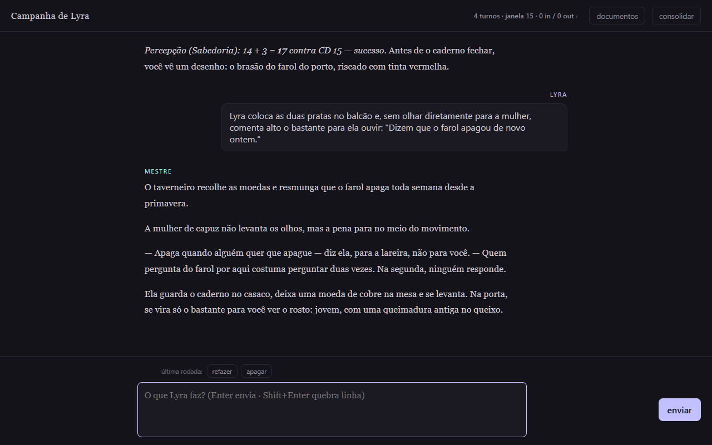
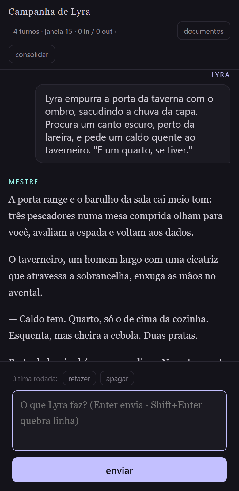

# solo-rpg-selfhosted

A self-hosted web app for playing a **solo tabletop RPG campaign with Claude as the game master**. Every turn is saved to your own disk before the model is even called, and the campaign stays readable as plain Markdown even if the app disappears.

> Leia em português: [README.pt-BR.md](README.pt-BR.md)



<p align="center"></p>

## Why it exists

I was playing a long D&D campaign in a chat interface when a sync failure erased three hours of play. The turns were eventually recovered from the provider's activity log, but the lesson stuck: a campaign that matters should not live in a chat tab.

So in this app durability is a property of the system:

- **Your turn is committed to SQLite before any model call.** At worst, you lose the reply in progress, never your action or the history.
- **The reply is saved as it streams.** If the connection drops mid-turn, a banner offers to keep or discard the partial text.
- **Everything is text.** The database is the source of truth, mirrored into Markdown files you can read, grep and back up with `cp`.

## How the context works

A long campaign doesn't fit in a prompt, and sending all of it every turn would be slow and expensive. My campaign had 304 turns, about 200k tokens. Instead, each turn the GM gets:

- `MESA.md`: the table's rules (who the player controls, how dice are rolled, language, tone). You edit this.
- `CANON.md`: the living state of the campaign: characters, places, factions, items and the current situation.
- The **last 15 turns**, in full.

That comes to about **13k input tokens** per turn instead of 200k. When the GM needs an older detail (an exact line, a price, a minor NPC's name), it uses **Grep and Read on `historico/*.md`** and pulls only that excerpt. Text search is enough here: names and places are exact strings, so embeddings would add a pipeline without adding recall.

The canon is kept current by **consolidation**: at the end of a session, or automatically once the turns that left the context window add up to a full window, the GM rewrites `CANON.md` with what changed. Without that, events that slid out of the window would be neither in context nor in the canon, and the GM wouldn't know to look for them.

**Measured cost:** a turn without searching is ~13k input tokens. A turn that searches the history is **~85k**, because every tool round-trip resends the context. `CONTEXT_WINDOW_TURNS` trades recent memory against cost.

## Guardrails on the GM

The GM has file tools on your server, so it is contained in three layers, covered by the tests:

1. A fixed working directory: the campaign folder.
2. A tool allowlist with no Bash, no Write and no network.
3. A permission callback that lets it edit only `CANON.md` and the character sheets (`ficha-*.md`). History and the table's rules are read-only. Absolute paths and `..` escapes are denied.

On top of that: a lock so two turns never run at once, a per-turn cap on tool round-trips (so a failed search can't loop), and a JSONL log of every model call with token counts.

## Features

- Streaming replies with Markdown rendering; the GM rolls the dice and shows the math.
- **Documents panel:** read and edit the canon, the table's rules and any reference file in the campaign folder (the previous version is kept as `.bak`).
- **Portrait galleries** per character, as a visual reference for image generation.
- **Regenerate or delete the last round** (your text goes back to the input box), and cancel a turn in progress.
- Usage panel: turns, tokens in and out, context size, and rate-limit windows when the API reports them.
- Phone layout.
- Single password, signed `HttpOnly` cookie, nothing else: it is a one-person app.

## Quick start

You need Docker with Compose and an [Anthropic API key](https://console.anthropic.com).

```bash
git clone https://github.com/gustavoacoelho/solo-rpg-selfhosted.git
cd solo-rpg-selfhosted
cp .env.example .env     # set ANTHROPIC_API_KEY, APP_PASSWORD and CHARACTER_NAME
docker compose up -d --build
```

Open http://localhost:8000. On first run the app writes a starter `MESA.md` and an empty `CANON.md` into the campaign volume; edit them from the **documentos** panel before your first turn.

Every setting lives in [.env.example](.env.example). Put it behind any HTTPS reverse proxy to reach it from your phone.

**Running without Docker** (Python 3.11+ and Node 18+, because the Agent SDK drives the Claude Code CLI):

```bash
npm install -g @anthropic-ai/claude-code
python -m venv .venv && . .venv/bin/activate
pip install -r requirements.txt
cp .env.example .env
./run.sh                 # http://127.0.0.1:8000
```

### Bringing an existing campaign

```bash
python -m scripts.import_campanha dados/turnos.json --canon dados/cronica.txt
```

The JSON is a list of `[role, text]` pairs in order, where the role is `"MESTRE"` for the GM and anything else for the player; see [examples/turnos-exemplo.json](examples/turnos-exemplo.json). `--canon` seeds `CANON.md` with a summary you already have.

## Language

The interface and the starter table rules are in **Brazilian Portuguese**, and so are the code and comments. The GM follows `MESA.md`: change its language line (and the tone, system and conventions) to play in English or anything else.

## How it's built

| Part | What it uses |
|---|---|
| Server | FastAPI + uvicorn, streaming over SSE |
| Game master | [Claude Agent SDK](https://docs.claude.com/en/api/agent-sdk/overview) with a restricted tool set and a permission callback |
| Storage | SQLite (source of truth) mirrored to Markdown, 40 turns per file |
| Front end | Plain HTML, CSS and JS, no build step |

## Tests

```bash
python tests/test_permissoes.py              # what the GM may and may not write
python tests/test_escrita_consolidacao.py    # write rules during consolidation
python -m pytest tests/test_desfazer.py tests/test_registro.py tests/test_trava.py
```

## About authentication

My own instance runs on my Claude subscription through the Agent SDK. Anthropic doesn't allow third-party apps to offer claude.ai login or subscription limits, so this public version uses an **API key**, billed per use.

## License

MIT. Bring your own setting: no game content is included.
