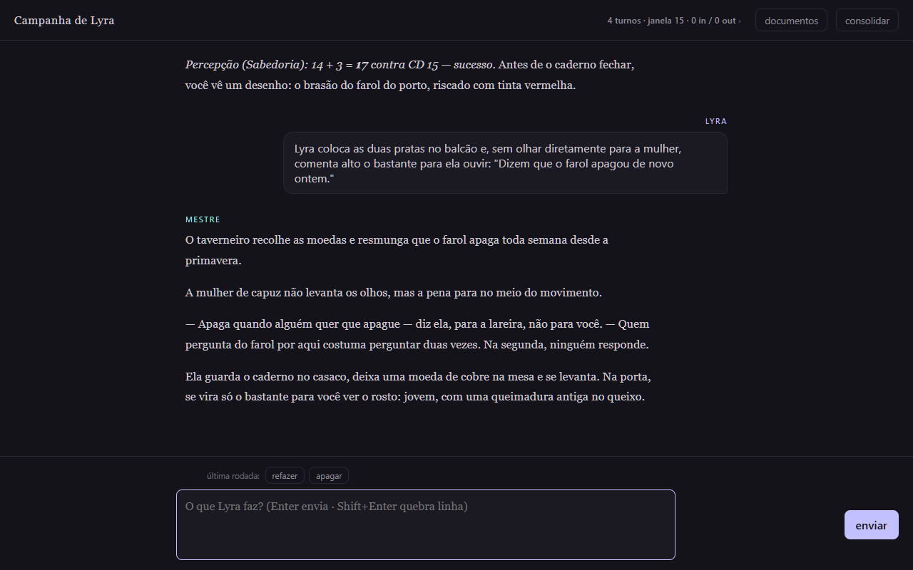
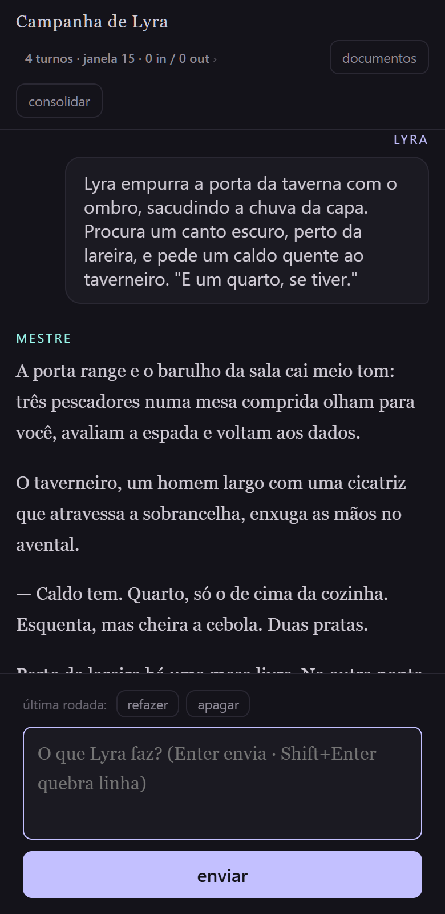

# solo-rpg-selfhosted

Um webapp próprio para jogar uma **campanha solo de RPG de mesa com o Claude como mestre**. Cada turno é gravado no seu disco antes mesmo de o modelo ser chamado, e a campanha continua legível em Markdown mesmo se o app deixar de existir.

> Read in English: [README.md](README.md)



<p align="center"></p>

## Por que existe

Eu jogava uma campanha longa de D&D numa interface de chat quando uma falha de sincronização apagou três horas de jogo. Os turnos acabaram recuperados pelo registro de atividade do serviço, mas a lição ficou: uma campanha que importa não deveria morar numa aba de chat.

Por isso, aqui a durabilidade é propriedade do sistema:

- **O seu turno é gravado no SQLite antes de qualquer chamada ao modelo.** No pior caso perde-se a resposta em andamento, nunca a sua ação nem o histórico.
- **A resposta é salva enquanto chega.** Se a conexão cair no meio, um aviso oferece manter ou descartar o texto parcial.
- **Tudo é texto.** O banco é a fonte de verdade, espelhado em arquivos Markdown que dá para ler, pesquisar e copiar com `cp`.

## Como o contexto funciona

Uma campanha longa não cabe num prompt, e mandá-la inteira a cada turno seria lento e caro. A minha tinha 304 turnos, cerca de 200 mil tokens. Em vez disso, a cada turno o mestre recebe:

- `MESA.md`: as regras da mesa (quem o jogador controla, como rolar os dados, idioma, tom). Você edita.
- `CANON.md`: o estado vivo da campanha: personagens, locais, facções, itens e a situação atual.
- Os **últimos 15 turnos**, inteiros.

Isso dá uns **13 mil tokens de entrada** por turno, em vez de 200 mil. Quando o mestre precisa de um detalhe antigo (uma fala exata, um preço, o nome de um NPC secundário), ele usa **Grep e Read em `historico/*.md`** e traz só o trecho. Busca textual basta aqui: nomes e lugares são strings exatas, então embeddings acrescentariam um pipeline sem achar mais nada.

O cânone se mantém atualizado pela **consolidação**: no fim da sessão, ou sozinha quando os turnos que saíram da janela somam uma janela inteira, o mestre reescreve o `CANON.md` com o que mudou. Sem isso, o que escorregou para fora da janela não estaria nem no contexto nem no cânone, e o mestre nem saberia que precisa procurar.

**Custo medido:** um turno sem busca gasta ~13 mil tokens de entrada. Um turno que pesquisa o histórico gasta **~85 mil**, porque cada ida e volta de ferramenta reenvia o contexto. O `CONTEXT_WINDOW_TURNS` troca memória recente por custo.

## Travas no mestre

O mestre tem ferramentas de arquivo no seu servidor, então fica contido em três camadas, cobertas pelos testes:

1. Diretório de trabalho fixo: a pasta da campanha.
2. Lista de ferramentas permitidas sem Bash, sem Write e sem rede.
3. Um callback de permissão que só deixa editar o `CANON.md` e as fichas (`ficha-*.md`). O histórico e as regras da mesa são só leitura. Caminhos absolutos e fugas por `..` são negados.

Além disso: uma trava para dois turnos nunca rodarem juntos, um teto de idas e voltas de ferramenta por turno (para uma busca malsucedida não virar laço) e um registro JSONL de cada chamada ao modelo, com os tokens.

## Recursos

- Respostas em streaming com Markdown; o mestre rola os dados e mostra a conta.
- **Painel de documentos:** ler e editar o cânone, as regras da mesa e qualquer arquivo de referência da pasta da campanha (a versão anterior fica como `.bak`).
- **Galerias de retratos** por personagem, como referência visual para gerar imagens.
- **Refazer ou apagar a última rodada** (o seu texto volta para a caixa) e cancelar um turno em andamento.
- Painel de uso: turnos, tokens de entrada e saída, tamanho do contexto e as janelas de limite quando a API informa.
- Layout para celular.
- Senha única e cookie `HttpOnly` assinado, nada mais: é um app de uma pessoa.

## Como rodar

Precisa de Docker com Compose e de uma [chave de API da Anthropic](https://console.anthropic.com).

```bash
git clone https://github.com/gustavoacoelho/solo-rpg-selfhosted.git
cd solo-rpg-selfhosted
cp .env.example .env     # preencha ANTHROPIC_API_KEY, APP_PASSWORD e CHARACTER_NAME
docker compose up -d --build
```

Abra http://localhost:8000. Na primeira vez o app cria um `MESA.md` inicial e um `CANON.md` vazio no volume da campanha; ajuste os dois no painel **documentos** antes do primeiro turno.

Todas as opções estão no [.env.example](.env.example). Coloque atrás de qualquer proxy reverso com HTTPS para jogar pelo celular.

**Sem Docker** (Python 3.11+ e Node 18+, porque o Agent SDK usa o CLI do Claude Code):

```bash
npm install -g @anthropic-ai/claude-code
python -m venv .venv && . .venv/bin/activate
pip install -r requirements.txt
cp .env.example .env
./run.sh                 # http://127.0.0.1:8000
```

### Trazendo uma campanha que já existe

```bash
python -m scripts.import_campanha dados/turnos.json --canon dados/cronica.txt
```

O JSON é uma lista de pares `[papel, texto]` em ordem, onde o papel é `"MESTRE"` para o mestre e qualquer outra coisa para o jogador; veja [examples/turnos-exemplo.json](examples/turnos-exemplo.json). O `--canon` semeia o `CANON.md` com um resumo que você já tenha.

## Como é feito

| Parte | O que usa |
|---|---|
| Servidor | FastAPI + uvicorn, streaming por SSE |
| Mestre | [Claude Agent SDK](https://docs.claude.com/en/api/agent-sdk/overview) com ferramentas restritas e callback de permissão |
| Dados | SQLite (fonte de verdade) espelhado em Markdown, 40 turnos por arquivo |
| Página | HTML, CSS e JS puros, sem etapa de build |

## Testes

```bash
python tests/test_permissoes.py              # o que o mestre pode e não pode gravar
python tests/test_escrita_consolidacao.py    # regras de escrita na consolidação
python -m pytest tests/test_desfazer.py tests/test_registro.py tests/test_trava.py
```

## Sobre a autenticação

A minha instância roda na minha assinatura do Claude pelo Agent SDK. A Anthropic não permite que apps de terceiros ofereçam o login ou os limites do claude.ai, então esta versão pública usa **chave de API**, cobrada por uso.

## Licença

MIT. O cenário é por sua conta: nenhum conteúdo de jogo vem junto.
